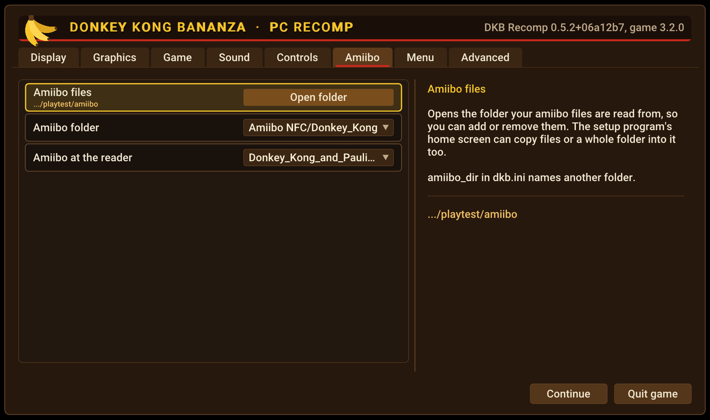
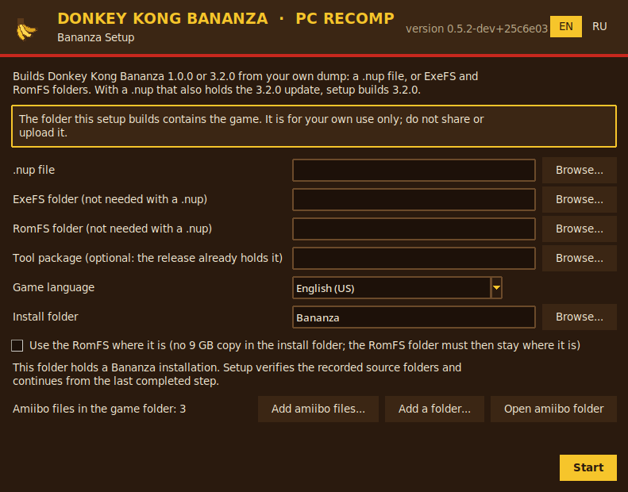

# amiibo

Bananza reads amiibo through `nn::nfp`. DKB Recomp answers those calls from a tag dump of your own, kept as a file:
no NFC reader is involved, and nothing is ever written to a tag or its file. All of it is in
[`runtime/ov_nfp.c`](../runtime/ov_nfp.c); the menu's Amiibo tab (`runtime/ui/menu.cpp` `tab_amiibo`) is its front.
Requested in [#508](https://github.com/Lucas-blip-png/dkb-pc-recomp/issues/508).

**No tag dump is ever committed, uploaded or attached to an issue.** The check builds a pretended tag in code
(`tests/nfp_tag_test.py`).

## Using it

1. Put your tag files in the `amiibo` folder next to the game program, in subfolders if you like. The menu's **Open
   folder** button (F1, Amiibo) opens it (a fullscreen game minimises itself), and the setup program's home screen
   copies files or a whole folder into it (**Add amiibo files...**, **Add a folder...**): on its home screen, and on
   the setup form once the install folder holds the game.
2. In the menu (F1, Amiibo), choose the subfolder in **Amiibo folder** and the figure in **Amiibo at the reader**. New
   files show up within two seconds; nothing needs a restart.
3. In the game, use the pause menu's amiibo option, or talk to a character who asks for one. The figure is found as
   soon as the game looks, is read, and counts as lifted off again; the next time the game looks, it is scanned again.

With **None** chosen (the default) the game is told there is no NFC reader, as before.

The menu's Amiibo tab, and the row of the setup program:

| File | Contents |
|---|---|
| `.bin` | The tag's bytes: 540 (an NTAG215's 135 pages), or 532 or 572 as some tools write them |
| `.nfc` | A Flipper Zero NFC file: `Page N: xx xx xx xx` lines, at least 130 pages |

A file is a figure's tag when its capability container says NTAG215 (`F1 10 FF EE` at `0x0C`) and its model ends in
`02` (byte `0x5B`). Only the model (`0x54`-`0x5B`) is read: which character, variant, type, number and series the
figure is. The rest of a real tag is encrypted and not needed, so no keys are involved.

## What the game does with it

Bananza imports thirteen `nn::nfp` functions and reads only the figure's model (`Mount` with the read-only target, then
`GetModelInfo`). It tells three kinds of figure apart (its own names: `DonkeyAndPauline`, `PastDonkeyKongSeries`,
`Others`), and what a scan gives depends on that alone. The pause menu's scan gives materials; the characters who ask
for an amiibo (in Center of the Divide once the story has got there, the Racing Layer and the Resort Layer) give their
own presents.

`ModelInfo` is `{characterId[3], seriesId, numberingId (u16), nfpType}`: the tag has the type before the number and the
series after it. With the bytes in the tag's order the game took the Donkey Kong and Pauline figure for one of an
earlier series.

## Settings

| `dkb.ini` key | Effect |
|---|---|
| `amiibo = <file>` | The tag at the reader (the menu writes it). Empty: no NFC reader |
| `amiibo_dir = <folder>` | The folder the menu lists tags from, in place of `amiibo` next to the program |
| `amiibo_folder = <subfolder>` | The subfolder the menu shows (the menu writes it) |

Not done: writing to a tag (the game does not ask for it), a real reader, and the tag's ID, owner and application
area, none of which Bananza imports.
